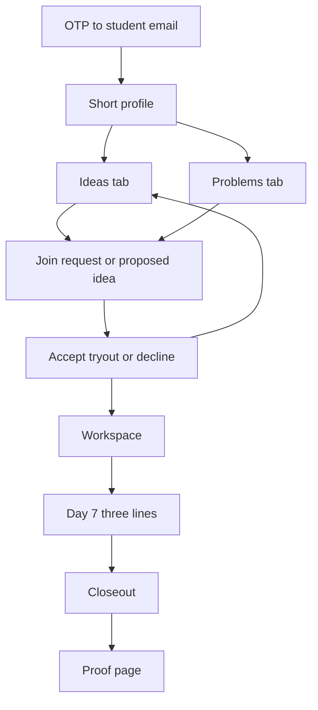
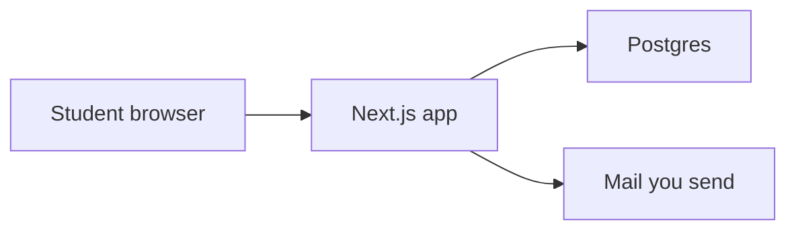
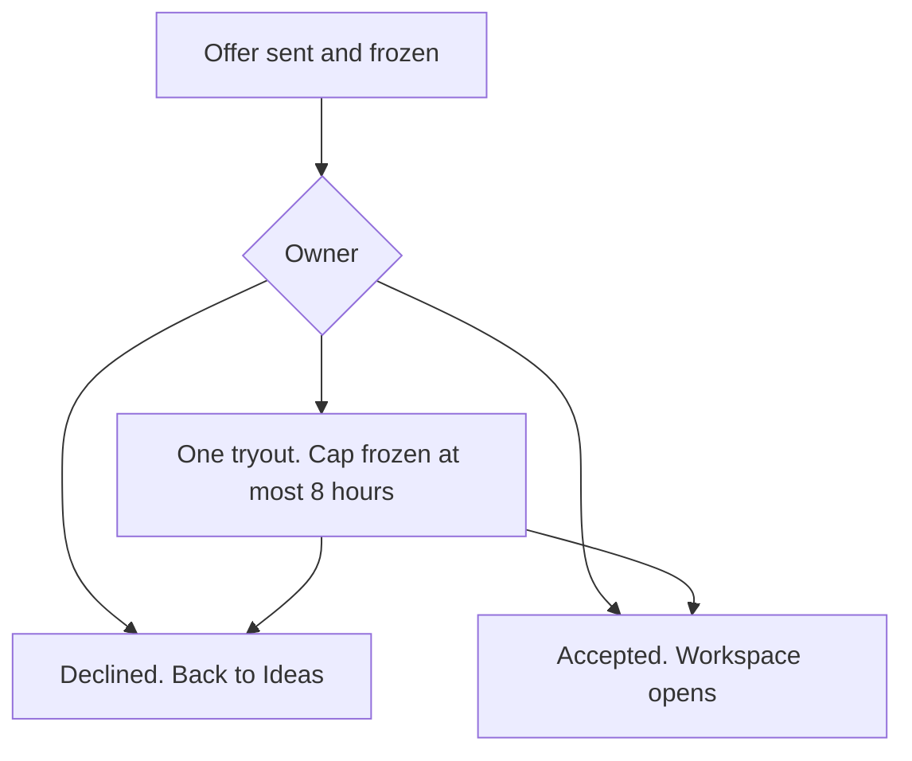
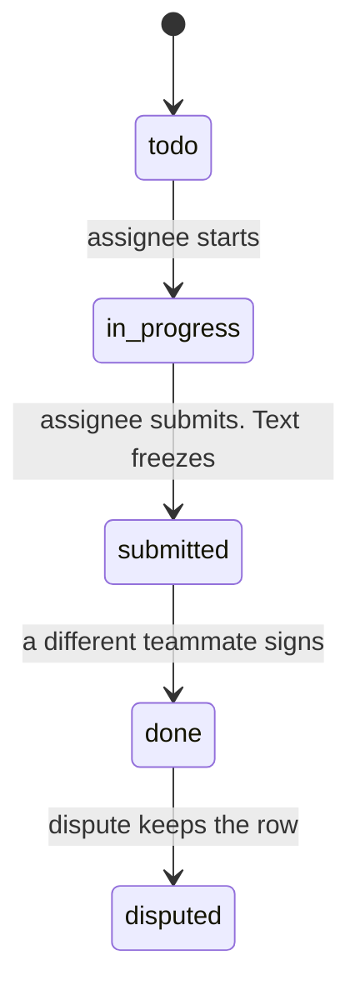
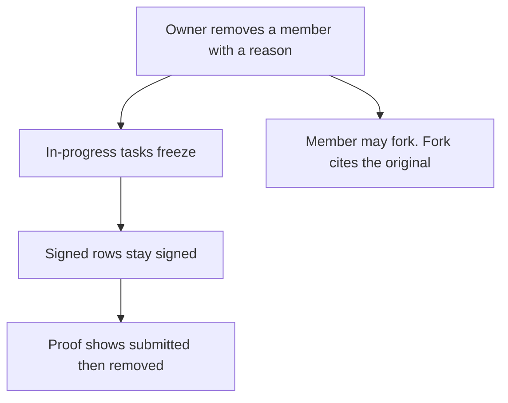
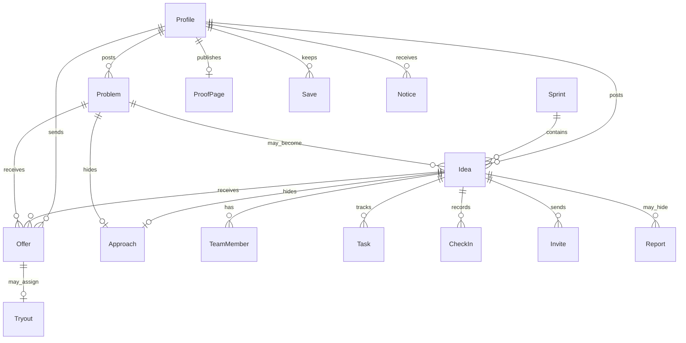

# Anvil, to build inside Embedra

This is the full product, architecture, and build list. Embedra already has ideas, join requests, groups, invites, and profiles. Anvil adds the campus sprint: a Problems tab, a hidden approach, a signed receipt, a tryout, a kick that cannot erase work, and a proof page. Do not replace Embedra’s shell. Add these rules beside it.

The first campus is any mailbox at `@bl.students.amrita.edu`. The site is not a university product. Do not use the university logo or the word official. There is no faculty login and no approval before a card is posted.

## What Embedra already has, and what to add

| Embedra today | Add from Anvil |
| --- | --- |
| Idea page, create, edit | Public brief plus a private approach row |
| Join request | Offer with hours, days, links. Status: new, tryout, accepted, declined |
| Group / chat | Workspace of tasks. Chat stays out of this sprint |
| Invite link | Invite by campus email. The person must accept. A seat is not a receipt |
| Profile | Name, branch, semester, at most 8 skills, interest tiles, two-week line |
| Ratings, upvotes, comments | Leave them off the Anvil sprint. Credit is a signature, not a score |
| Any email | Login only for `@bl.students.amrita.edu`, by a one-time code. No Microsoft login |
| One idea object | A second object, Problem, that can become an idea |

## Path

There is no separate signup. The first code creates the account.

1. The student enters their university email. A code arrives in Outlook. They enter the code.
2. A short profile comes before the board: name, branch, semester, at most eight skills, interests, and what they can take on in two weeks. Hours and links wait until a join request.
3. Two tabs, same campus, same 14-day sprint. Ideas is the default. Problems is the other list. Filters are branch and semester. Nothing auto-picks a teammate.
4. A problem’s public text is complete: what is happening, who it affects, what a fix would change, and whether the poster lives with it or heard it. Deeper notes and the contact email stay hidden until that poster accepts someone.
5. An idea’s public text is complete: pitch, who it is for, what must exist by the end of the sprint, and open roles. The approach, contact email, and extra notes stay hidden until accept. The author may hide their name. Branch and semester still show. Teammates see the name after accept.
6. The owner chooses what a request includes: contribution, hours per week, and links. A resume, if wanted, is a link. There is no file upload.
7. The owner sees the request beside the profile and accepts, asks for one tryout, or declines.
8. Accept opens the workspace. Decline returns the person to Ideas. Accepting a proposal on a problem publishes an idea: the problem source stays the poster, the idea author is the person who wrote the build. Both credits are immutable.

## Screens

| Route | Job |
| --- | --- |
| `/` | Public first page. Explains the sprint. Live cards stay behind login |
| `/login` | Campus email, then the code. First code creates the account |
| `/profile` | Three steps: who you are, interest tiles, skills and the two-week line |
| `/ideas` | Projects that need people. Filter by branch and semester. Search by title |
| `/ideas/new` | Post an idea. Public fields and a private approach |
| `/ideas/[id]` | Full public brief, open roles, join form. Approach hidden |
| `/ideas/[id]/work` | Unlocked notes, team, tasks, day-7 lines, ship. Members only |
| `/problems` | Pains other branches can turn into ideas. Filter “no idea yet” |
| `/problems/new` | Post a problem. Lived or heard |
| `/problems/[id]` | Public pain, and a proposal form |
| `/offers/[id]` | Accept screen. Request on the left, profile on the right |
| `/inbox` | New, Tryout, Decided, plus invites and notices |
| `/invites/[id]` | Accept or decline an invite |
| `/proof` | Signed lines, plus that person’s own submitted, disputed, or removed lines. Off until shared |
| `/reports` | Cards hidden by spam or copied-work reports. Admin resolves them |
| `/help` | Answers from these rules. It cannot accept, remove, ship, or sign |

Logged-out visitors can read `/` and `/login`. Every other route requires a session. Queries use that user’s session. The service role key is not used for ordinary reads.

## Profile

Branch codes: CSE, AIE, ECE, EEE, ME, EAC. Semester is 1 through 8. Cards and filters use these codes, not free text.

Interest tiles: Mess and food, Hostel life, Labs and equipment, Buses and commute, Library, Clubs and fests, Internships, Sports, Health, Admin paperwork, Wi-Fi and campus tech, Environment.

Skill chips, at most eight: TypeScript, Python, React, Figma, Writing, Research, Arduino, Electronics, CAD, Android, Photography, Outreach. A student may add their own until the cap.

A skill is marked signed only when a receipt used it. The others say self-reported. There are no stars.

The email local-part may hint the branch (`cse`, `aie`, `ece`, `eee`, `eac`, `me`, `mec`). `me` must not match inside a word such as `demo`.

## Two tabs

| Tab | What a student does |
| --- | --- |
| Ideas | Open a project and ask to collaborate |
| Problems | Read what is going on. Propose an idea that cites that problem |

Neither tab has votes or a comment thread on the Anvil path. Open cards stay above shipped ones. A student can privately save a card. Saves have no public count.

An idea that came from a problem shows that problem on one line. The problem card, once accepted, is labeled **Has an idea** and points at the idea. People who saved the problem get one mail when an idea from it is accepted.

A problem with no proposal by day 7 asks the author for one fresh line, or it sinks below problems that are still active.

## Cards

**Idea, public.** Title, pitch, branch, semester, open roles, stage, team status, hour cap if it is marked small, who it is for, what will exist in two weeks, what is still missing, compensation sentence, publish time. Stage is Idea, Prototype, Building, or Launched. Team status is Open, In build, or Shipped.

**Idea, private until accept.** Approach, contact email, extra notes. Own table, not columns on the public row.

**Problem, public.** What happens, who feels it, what a fix would change, lived or heard.

**Problem, private until accept.** Deeper notes and contact email.

The idea author cannot be reassigned. The problem source cannot be reassigned. Later edits are an append-only revision list. A repeated title or pitch links to the earlier card instead of publishing again. Forks set `duplicate_of_id` and skip that duplicate check. Several students may propose ideas from one problem. The poster accepts one. The others stay declined.

Compensation is one sentence. The default is: Volunteer. No pay, no equity, no academic credit. Pay, equity, and academic credit cannot appear as a bare badge. The site records who published the idea and who signed the work. It does not grant ownership of the idea. It does not certify copyright.

A card that is only a link, or the same sentence repeated, is rejected. The pitch and “what will exist” must be the student’s own words and must name a finishable result. Each student may post two ideas and two problems per sprint. Forks do not count toward the cap.

## Accept, tryout, team

The accept screen is split. Left: contribution, hours, days, links. Right: branch, semester, skills, how many offers they finished or dropped, two-week line. Signed skills are separate from self-reported skills.

One tryout per request. The hour cap is at most 8 and is frozen before they start. A declined tryout still writes a receipt for the applicant.

Teams have at most four people, including the author. The author is the idea’s `author_id` and is not also inserted as a collaborator row. Adding someone is an invite they must accept. Leaving keeps every submitted and signed row.

Accepting a problem proposal creates the idea inside the same transaction. The proposal body must be at least 40 characters and must not be a copy of the problem text. Only the problem poster is inserted as a team member. The person who wrote the build is the idea author.

## Workspace and credit

Tasks are To do, In progress, Submitted, and Done.

The assignee may move a task to In progress. They may Submit, which freezes the description, the links, and the time. That row cannot be edited or deleted afterward. A different teammate marks it Done. That signature is the receipt. Self-sign is forbidden.

On day 7 each member writes three lines: done, stuck, next. Silence reopens that role. On day 13 the team confirms or disputes each signed line. The idea author marks the sprint shipped or not. A dispute keeps the row and changes its status. The shipped summary shows signed lines only.

## Removal

The owner can remove a member with a reason. The owner cannot erase what that member already submitted.

A removal stores who did it, when, and the reason, and it emails the member. Every in-progress task of that member freezes at that moment, even if they had not pressed Submit. Signed receipts stay signed. Frozen submissions stay on that member’s proof page as submitted, then removed, with both timestamps.

The removed member may fork the idea. The fork is a new idea that cites the original and carries the frozen submissions. The original keeps the removal. Work does not move onto the owner’s proof page.

## Proof page

One page per student. Unpublished by default. When shared, other students see signed lines only. The owner always sees their own submitted, disputed, and removed lines, with both times.

## Reports

A report of spam or copied work hides the card until an admin restores it or leaves it hidden. The author and the publish time stay stored. An admin does not read every idea before it is posted. The admin queue is reports only.

## Mail

Send from a domain you control. The university inbox only receives mail.

| When | Who |
| --- | --- |
| Login code | The student |
| A request arrives | The idea or problem owner |
| Day-7 reminder | Each member who has not checked in |
| Closeout | The team |
| Removal | The removed member |
| A saved problem gains an idea | Each student who saved that problem |

## Assistant

One Gemini Flash key. If that request errors, retry the same call once on Grok. A finished quota is not routed through more free keys. The model drafts public text, warns about a tryout that reads like a whole product, and answers help questions from this spec and from cards that student can already read. It cannot accept, remove, ship, or sign. Drafting stays off until `GEMINI_API_KEY` is set.

## Data

### profiles

| Field | Rule |
| --- | --- |
| id | Same as the auth user |
| email | Unique. Domain `@bl.students.amrita.edu` |
| name, branch, semester | Required before posting |
| skills | At most 8 |
| interests | From the tiles, plus any the student already saved |
| two_week_line | Required |
| hours_per_week, available_days, github_url, site_url | Optional. Not on the first screen |
| is_admin | Reports queue only |

Own-row access. Other students read a profile through `offer_profile`, not by selecting the table.

### sprints

One row, id 1. `ends_at` closes new requests. Day 7 is seven days before `ends_at`.

### ideas

| Field | Rule |
| --- | --- |
| author_id | Immutable |
| problem_id | Set when accepted from a problem |
| duplicate_of_id | Fork or near-duplicate. Skips the duplicate check |
| title, pitch, audience, gap, ships | Public. Pitch and ships must be long enough and in the student’s words |
| stage | idea, prototype, building, launched |
| status | open, in_build, shipped |
| help_needed | Role strings |
| small, hour_cap | Together, when a first build can join |
| compensation_sentence | One sentence. Default volunteer |
| hide_name | Branch and semester still show. `author_name` empty when hidden |
| author_name, author_branch, author_semester | Snapshot on the card |
| created_at | Publish time |

### problems

| Field | Rule |
| --- | --- |
| author_id | Immutable |
| title, what_happens, who_feels, fix_would_change | Public and complete |
| source | lived or heard |
| author_name, author_branch, author_semester, hide_name | Same name rule as ideas |
| created_at | Publish time |

### approaches

`idea_id` or `problem_id`, `body`, `contact_email`. Readable by the author and accepted teammates only.

### revisions

Append-only. `target_type`, `target_id`, snapshot, `created_at`. Rows are not updated in place.

### offers

One open offer per student per sprint. `builder_id`, `idea_id` or `problem_id`, `body`, `hours_per_week`, `available_days`, `links`. Body, hours, and days freeze when sent. Status: new, tryout, accepted, declined.

### tryouts

At most one per offer. `brief`, `hour_cap` (at most 8), `outcome`. Frozen at assignment.

### team_members

`idea_id`, `user_id`, `left_at`, `exit_reason`. Cap is four including the author, so three active collaborator rows means the team is full on the idea path.

### tasks

`title`, `description`, `links`, `role`, `status` (todo, in_progress, submitted, done), `assignee_id`, `receipt_status` (signed, submitted, disputed, removed), `frozen_at`, `signed_at`, `removed_at`, `witness_id`. No delete. Frozen text cannot be edited.

### check_ins

`idea_id`, `user_id`, `done`, `stuck`, `next`.

### proof_pages

`user_id`, `published`. Default false.

### invites

`idea_id`, `email`, `status`. The invited student accepts or declines.

### reports

`target_type`, `target_id`, `reason` (spam or copied work), `resolved`. Filing hides the card.

### saves

`user_id`, `target_type`, `target_id`. Private. No public count.

### notices

`user_id`, `body`, `target_id`, `read_at`.

### events

Append-only log of join, kick, submit, and signature. No client policies.

## Server functions

These run as the logged-in user. The client does not write the frozen fields itself.

| Function | Effect |
| --- | --- |
| accept_offer | Accepts. On a problem, publishes the idea and opens the workspace |
| decline_offer | Declines. Returns the person to Ideas |
| assign_tryout | One tryout. Cap frozen, at most 8 |
| add_task | Owner adds a task, optional role |
| start_task | Assignee moves it to in progress |
| update_task_draft | Assignee edits until submit |
| submit_task | Assignee freezes the text |
| sign_task | A different teammate signs. Self-sign fails |
| dispute_task | Owner disputes. Row stays |
| ship_idea | Author only. Shipped summary is signed lines |
| check_in | Day-7 done, stuck, next |
| invite_member | Email invite. Does not add the seat until accepted |
| respond_invite | Accept or decline |
| leave_team | Keeps submitted and signed rows |
| remove_member | Owner, with a reason. Freezes that member’s open tasks. Cannot delete submissions |
| fork_idea | New idea citing the original. Carries frozen submissions. Exempt from the two-idea cap and the duplicate check |
| offer_profile | Profile the owner is allowed to see for one offer |
| team_roster | Names on a team the caller belongs to |
| proof_lines | Owner sees every personal line. Others see signed lines only if the page is shared |
| publish_proof | Turns sharing on or off |
| file_report | Hides the card |
| resolve_report | Admin restores or leaves hidden |

## What the server rejects

- Email domain is not `@bl.students.amrita.edu`.
- Profile is incomplete and the student tries to post.
- More than two ideas or two problems in the sprint, excluding forks.
- A second open offer.
- Pitch, gap, and “what will exist” are the same sentence, only a link, or too short.
- An exact title or pitch duplicate, unless `duplicate_of_id` is set.
- Team would pass four including the author.
- Witness is the person being credited.
- A write changes `author_id` or deletes a submitted task.
- Someone other than the idea author marks shipped.
- A removal tries to delete submissions.
- Tryout cap above 8, or a brief edited after assignment.

## Build order inside Embedra

1. Campus email check and one-time code. No separate signup.
2. Profile fields and the three-step picker. Block posting until it is complete.
3. Problem table, problem list, problem page, propose form.
4. Approach table. Stop selecting it on the public board.
5. Offer statuses, the split accept screen, tryout.
6. Accepting a problem proposal creates the idea with both credits fixed.
7. Tasks with submit freeze and a different signer.
8. Day-7 check-in, dispute, ship.
9. Removal, fork, proof page.
10. Reports that hide a card. Admin sees only that queue.
11. Saves, notices, and the mails listed above.
12. Gemini Flash draft on the idea and problem forms, with one Grok retry. No tool that changes membership or receipts.

## Out of scope for this sprint

Match scores, votes, reputation points, endorsements, a student directory, a news feed, team chat, long articles, file uploads, faculty approval, posts with no account, Microsoft login, and a model that accepts, removes, or signs. A second campus, an institution dashboard, and GitHub as a witness wait until this sprint has signed receipts.
